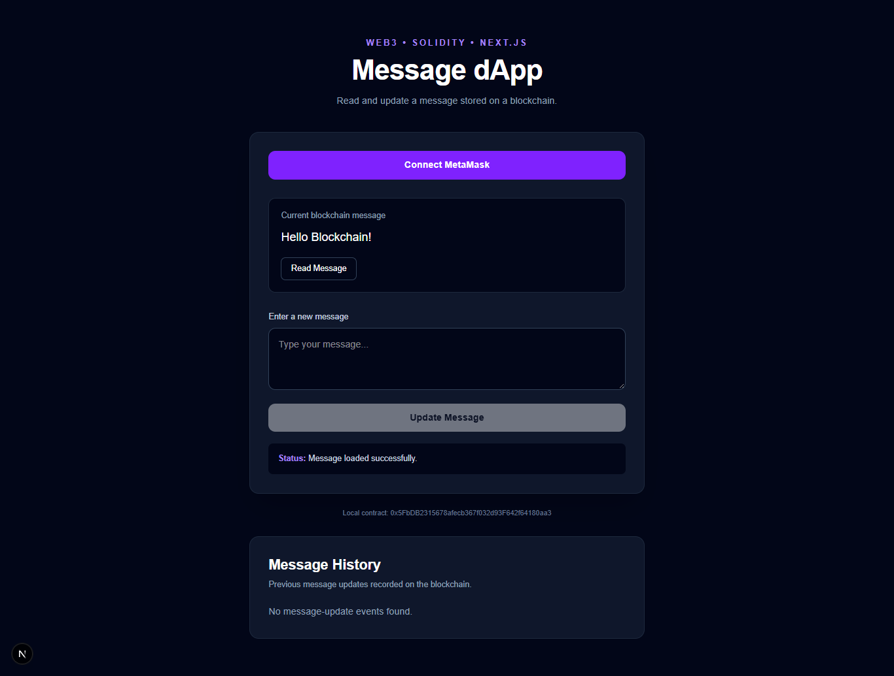
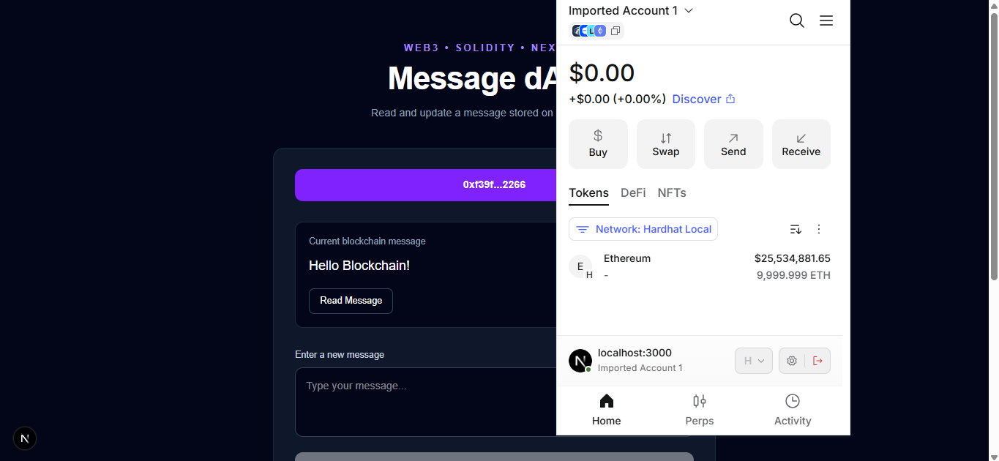
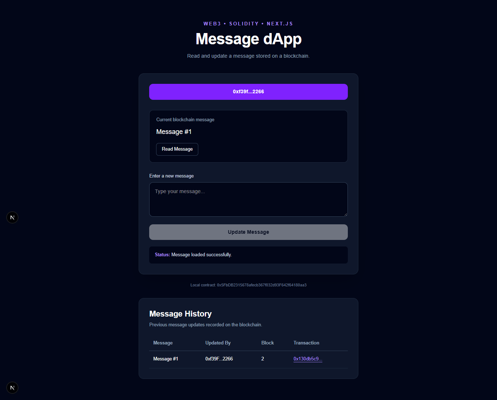
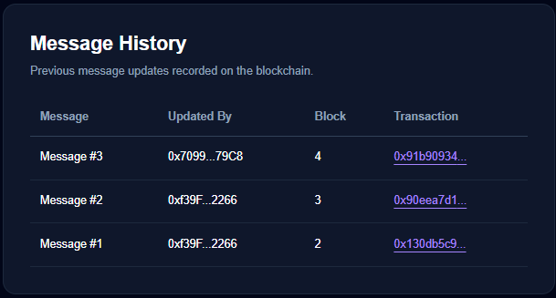

# Message dApp — Blockchain Message Board

A decentralized application (dApp) that allows users to read and update a message stored on the Ethereum blockchain. Built with Solidity, Hardhat, Next.js, and ethers.js, with MetaMask wallet integration.

## Features

- **Read blockchain data:** Retrieve the current message from the deployed smart contract.
- **Update messages:** Submit blockchain transactions through MetaMask.
- **Wallet integration:** Connect using an Ethereum-compatible wallet.
- **Transaction history:** View previous message updates, wallet addresses, block numbers, and transaction hashes.
- **Network validation:** Detect an incorrect network before submitting an update.
- **Transaction feedback:** Display transaction progress, success, and error messages.
- **Smart contract tests:** Test message reading, updating, and access from different wallets.

## Screenshots

### Main Interface



### Connected Wallet



### Successful Message Update



### Blockchain Message History



## Technology Stack

| Technology | Purpose |
|---|---|
| Solidity | Smart contract development |
| Hardhat 3 | Local blockchain development and testing |
| Next.js | Frontend application |
| React | User interface |
| TypeScript | Type-safe application code |
| ethers.js | Blockchain communication |
| MetaMask | Wallet connection and transaction approval |
| Tailwind CSS | Interface styling |

## Project Structure

```text
message-dapp/
├── contracts/
│   ├── Message.sol
│   ├── MessageOnlyOwner.sol
│   ├── Counter.sol
│   └── Counter.t.sol
├── frontend/
│   ├── src/
│   │   ├── app/
│   │   │   ├── page.tsx
│   │   │   ├── pageOnlyOwner.tsx
│   │   │   └── Message.json
│   │   └── lib/
│   ├── package.json
│   └── next.config.ts
├── scripts/
│   └── deploy-message.ts
├── test/
│   └── Message.ts
├── screenshots/
├── hardhat.config.ts
├── package.json
└── README.md
```

## Prerequisites

Install the following before running the project:

- Node.js and npm
- Git
- MetaMask browser extension
- Visual Studio Code or another code editor

## Getting Started

### 1. Clone the Repository

```bash
git clone https://github.com/ShahnoorElahi/message-dapp.git
cd message-dapp
```

### 2. Install Smart Contract Dependencies

Run this command from the project root:

```bash
npm install
```

### 3. Start the Local Blockchain

Open a terminal in the project root and run:

```bash
npx hardhat node
```

Keep this terminal running. It provides the local blockchain RPC endpoint:

`http://127.0.0.1:8545`

The local Hardhat network uses chain ID `31337`.

### 4. Deploy the Smart Contract

Open a second terminal in the project root and run:

```bash
npx hardhat run scripts/deploy-message.ts --network localhost
```

Copy the contract address printed in the terminal.

**Important:** When deploying to a fresh local blockchain, verify that the contract address configured in the frontend matches the newly deployed contract. Ensure the frontend ABI matches `Message.sol` as well.

### 5. Configure MetaMask

Configure a local development network in MetaMask:

- Network name: Hardhat Local
- RPC URL: `http://127.0.0.1:8545`
- Chain ID: `31337`
- Currency symbol: `ETH`

For local testing, import a test account using a private key provided by the local Hardhat node. Use only local development accounts and never use a real wallet's private key or recovery phrase.

### 6. Install Frontend Dependencies

Open a third terminal:

```bash
cd frontend
npm install
```

### 7. Run the Frontend

From the `frontend` directory:

```bash
npm run dev
```

Open the URL printed by Next.js, normally:

`http://localhost:3000`

Connect MetaMask, select the Hardhat Local network, and test reading and updating the message.

## Running Tests

From the project root:

```bash
npx hardhat test
```

The tests cover smart contract behavior, including message retrieval and updates by different accounts.

## Important Notes

- This project is configured for local blockchain development by default.
- Local blockchain data is temporary and may reset when the local node is restarted.
- The contract address may change when deploying to a new network or a fresh chain.
- Local Hardhat test accounts and their private keys are for development only.
- This project has not been documented here as a production or mainnet deployment.

## Future Improvements

- Deploy the contract to a public test network.
- Host the Next.js frontend.
- Add automated deployment and integration testing.
- Improve wallet event handling and cross-wallet live updates.

## Author

**Shahnoor Elahi**

GitHub: [@ShahnoorElahi](https://github.com/ShahnoorElahi)

Project Repository: [message-dapp](https://github.com/ShahnoorElahi/message-dapp)
